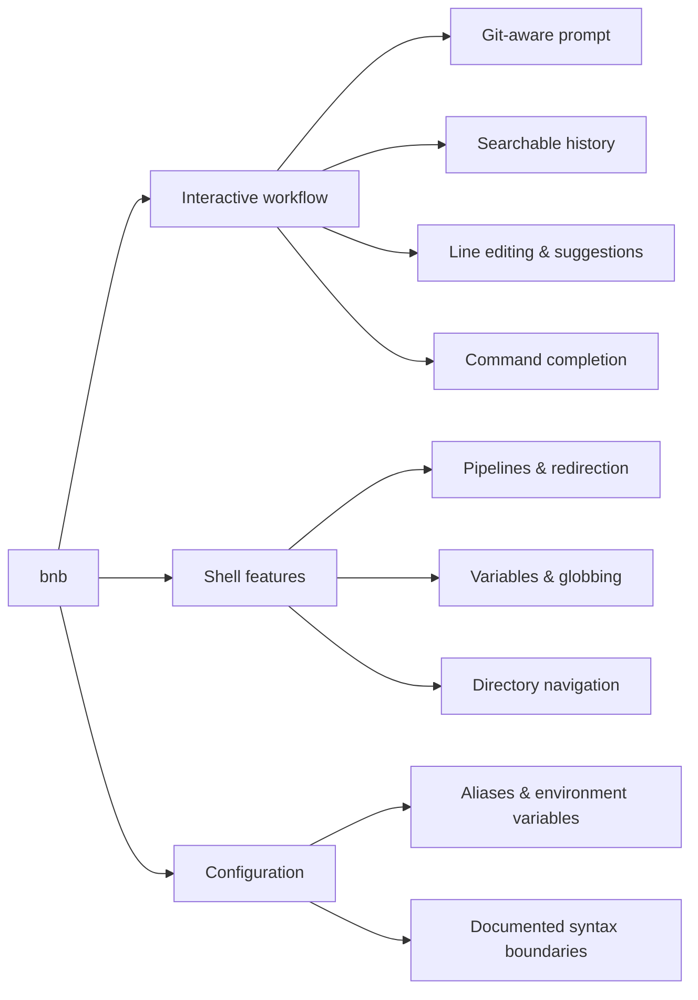

# Hi, I’m Chris (CJ)

I’m a software engineer and CTO based in Somerset, UK. I build web products, cloud platforms and developer tools, and like staying hands-on from early design through to production.

I currently lead engineering at [NovaCore Hosting](https://novacorehosting.com). Outside of work, I’m building **[bnb](https://github.com/EatSleepCode-Repeat/bnb)**, a Rust shell with a zsh-inspired workflow and a clearly defined scope.

## What I’m building

### [bnb](https://github.com/EatSleepCode-Repeat/bnb)

An interactive shell with a Git-aware prompt, command-line editing, searchable history and suggestions. It’s zsh-inspired, not a drop-in zsh replacement; the README documents what it supports and where its boundaries are.

